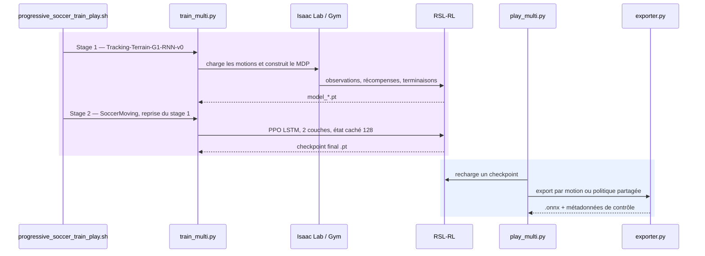
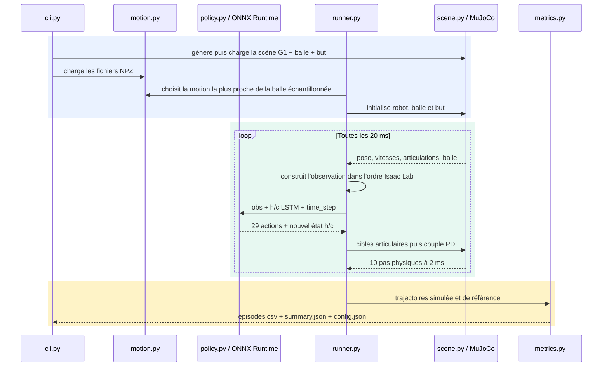

# Architecture du dépôt HumanoidSoccer

Ce document est une carte de reprise du dépôt. Il distingue le pipeline d'entraînement Isaac Lab du pipeline léger d'inférence et d'évaluation MuJoCo.

## Vue d'ensemble

```mermaid
flowchart LR
    subgraph Data["Données et modèle"]
        Motions["motions/**/*.npz<br/>trajectoires de référence"]
        Weights["ckp/policy_30000.onnx<br/>politique LSTM entraînée"]
        Robot["assets/.../mjcf/*.xml<br/>Unitree G1, 29 articulations"]
    end

    subgraph Training["Entraînement / export — Isaac Lab"]
        Train["scripts/rsl_rl/train_multi.py"]
        Task["soccer/tasks/tracking<br/>scène + MDP + récompenses"]
        PPO["RSL-RL PPO récurrent"]
        PT["logs/.../model_*.pt"]
        Export["scripts/rsl_rl/play_multi.py<br/>soccer/utils/exporter.py"]
    end

    subgraph Sim2Sim["Inférence / évaluation — MuJoCo"]
        CLI["exp/mujoco_soccer_experiment.py"]
        Loader["motion.py + policy.py"]
        Runner["runner.py<br/>boucle de contrôle"]
        Sim["scene.py<br/>MuJoCo + commande PD"]
        Results["exp/results/...<br/>CSV + JSON + MJCF généré"]
    end

    Motions --> Task
    Task --> Train --> PPO --> PT --> Export --> Weights
    Motions --> Loader
    Weights --> Loader
    Robot --> Sim
    CLI --> Loader --> Runner --> Sim
    Sim -->|"état physique"| Runner
    Runner --> Results

    style Data fill:#EAF2FF,stroke:#2563EB,stroke-width:3px,color:#172554
    style Training fill:#F3E8FF,stroke:#7E22CE,stroke-width:3px,color:#3B0764
    style Sim2Sim fill:#E7F8F1,stroke:#15803D,stroke-width:3px,color:#052E16

    classDef dataSource fill:#DBEAFE,stroke:#3B82F6,stroke-width:2px,color:#172554
    classDef dataModel fill:#BFDBFE,stroke:#1D4ED8,stroke-width:2px,color:#172554
    classDef trainingEntry fill:#EDE9FE,stroke:#8B5CF6,stroke-width:2px,color:#2E1065
    classDef trainingCore fill:#DDD6FE,stroke:#7C3AED,stroke-width:2px,color:#2E1065
    classDef trainingArtifact fill:#C4B5FD,stroke:#6D28D9,stroke-width:2px,color:#2E1065
    classDef simEntry fill:#D1FAE5,stroke:#10B981,stroke-width:2px,color:#064E3B
    classDef simCore fill:#A7F3D0,stroke:#059669,stroke-width:2px,color:#064E3B
    classDef simOutput fill:#6EE7B7,stroke:#047857,stroke-width:2px,color:#064E3B

    class Motions,Robot dataSource
    class Weights dataModel
    class Train,Export trainingEntry
    class Task,PPO trainingCore
    class PT trainingArtifact
    class CLI simEntry
    class Loader,Runner,Sim simCore
    class Results simOutput
```



La couleur de fond représente le sous-système : **bleu** pour les artefacts, **violet** pour l'entraînement Isaac Lab/RSL-RL et **vert** pour le sim2sim MuJoCo. Les nuances distinguent les entrées, le cœur de calcul et les sorties à l'intérieur d'un même sous-système.

## Artefacts présents

| Artefact | Rôle | Ce qu'il permet |
|---|---|---|
| `ckp/policy_30000.onnx` | Politique entraînée exportée, environ 1,49 Mo | Inférence dans MuJoCo via ONNX Runtime |
| `motions/soccer-standard/*.npz` | 10 trajectoires de référence de tirs | Sélection du mouvement, références articulaires et métriques |
| `motions/soccer-stylized/*.npz` | 3 trajectoires stylisées | Variante de jeu de mouvements |
| `source/.../mjcf/g1_actuator.xml` | Modèle physique du Unitree G1 | Construction de la scène MuJoCo |
| `logs/.../model_*.pt` | Checkpoints RSL-RL natifs | Reprise d'entraînement ou réexport ONNX |

Le dernier type est produit par l'entraînement mais n'est pas versionné dans l'état actuel du dépôt. Le fichier ONNX contient bien le graphe et les paramètres appris (`export_params=True` dans `soccer/utils/exporter.py`) ; ce n'est pas un pointeur Git LFS. Il suffit pour exécuter la politique, mais pas pour reprendre PPO.

## Flux d'entraînement et d'export



Les environnements Gym sont enregistrés dans `source/whole_body_tracking/soccer/tasks/tracking/config/g1/__init__.py`. Le stage 2 recommandé est `Tracking-Flat-G1-SoccerMoving-RNN-v0`. Sa configuration ajoute la balle, la cible, les observations de position et les récompenses de contact, direction et vitesse à la base de suivi de mouvement.

## Flux d'un rollout MuJoCo



### Contrat de contrôle important

La politique ne commande pas directement des couples. Elle produit 29 actions normalisées :

```text
cible articulaire = position par défaut + action × échelle
couple = Kp × (cible - position) - Kd × vitesse
```

`scene.py` applique ensuite les limites de couple. `constants.py` maintient deux ordres d'articulations et les permutations `ISAACLAB_TO_MUJOCO_REINDEX` / `MUJOCO_TO_ISAACLAB_REINDEX`. Une erreur dans cet ordre rendrait une politique valide physiquement incohérente.

L'observation concatène les références articulaires, la gravité projetée, les vitesses angulaires, l'état des 29 articulations, la dernière action, la position locale de la balle et celle du but. `policy.py` lit la dimension attendue dans l'ONNX et conserve l'état récurrent LSTM entre deux pas ; il le remet à zéro au début de chaque essai.

## Responsabilités des dossiers

- `source/whole_body_tracking/soccer/` : package Isaac Lab, robot, tâches, MDP, récompenses et exporteur ONNX.
- `scripts/rsl_rl/` : points d'entrée entraînement, reprise, lecture et export.
- `shell/` : orchestration du curriculum stage 1 puis stage 2.
- `motions/` : démonstrations humaines converties en trajectoires G1.
- `ckp/` : politiques d'inférence publiées.
- `exp/mujoco_soccer/` : sim2sim autonome, sans dépendance Isaac Lab.
- `exp/results/` : sorties générées et ignorées par Git.

## Exécution locale minimale avec `uv`

Le pipeline MuJoCo n'a pas besoin d'Isaac Lab. Depuis la racine du dépôt :

```bash
uv venv .venv
source .venv/bin/activate
uv pip install numpy mujoco onnxruntime
mjpython exp/mujoco_soccer_experiment.py \
  --policy ckp/policy_30000.onnx \
  --motion-path motions/soccer-standard \
  --num-trials 1 \
  --visualize \
  --pause-at-end \
  --camera-distance 4.0
```

Sur macOS, `mjpython` est requis par le viewer passif utilisé dans `runner.py`; il est installé avec le paquet Python `mujoco`. La caméra suit le bassin du robot, `--camera-distance` règle son recul et `--pause-at-end` conserve le dernier état jusqu'à la fermeture de la fenêtre. Pour un premier diagnostic sans fenêtre, retirer `--visualize` et `--pause-at-end`, puis utiliser simplement `python` ou `mjpython`. Les résultats se trouvent dans le nouveau sous-dossier horodaté de `exp/results/`.

### MuJoCo App, MuJoCo Studio et le script du dépôt

Les applications autonomes peuvent charger et inspecter un fichier MJCF/XML, mais le fichier ne contient ni la politique ONNX ni la boucle Python qui reconstruit les observations et applique les actions. Ouvrir seulement le XML montre donc le modèle physique, pas nécessairement le comportement appris.

Le test complet doit être démarré avec la commande `mjpython ... --visualize` ci-dessus. Le script :

1. génère `exp/results/<horodatage>/g1_soccer_experiment.xml` ;
2. charge l'ONNX avec ONNX Runtime ;
3. fait avancer la simulation et applique le contrôleur ;
4. ouvre le viewer classique MuJoCo et le synchronise à chaque pas.

Après un premier lancement, le XML généré peut aussi être ouvert dans MuJoCo App ou Studio pour inspecter la scène, les articulations, contacts et paramètres. Cette ouverture est utile pour le diagnostic visuel, mais elle ne rejoue pas la politique. Intégrer directement la boucle ONNX dans Studio demanderait un plugin de simulation dédié ; ce n'est pas nécessaire pour un premier test.

## Risques et hypothèses à garder en tête

- **Sim2sim n'est pas une validation sim2real.** Le même contrôleur peut être stable dans MuJoCo et échouer sur le robot réel à cause des délais, frottements, moteurs et estimations d'état.
- **Le fichier ONNX est récurrent.** Réutiliser son état caché entre deux épisodes crée une dépendance indésirable ; `PolicyBank` appelle correctement `reset()`.
- **La motion reste nécessaire.** L'ONNX publié est utilisé avec une trajectoire NPZ, notamment pour les références et l'évaluation ; ce n'est pas une politique autonome sans contexte.
- **Les métadonnées sont un contrat.** Raideur, amortissement, position par défaut, échelle d'action et noms d'articulations doivent rester cohérents avec l'entraînement.
- **L'environnement Python courant est incomplet.** Au moment de cette cartographie, `uv` est disponible, mais `mujoco`, `onnx` et `onnxruntime` ne sont pas installés dans le Python système.
